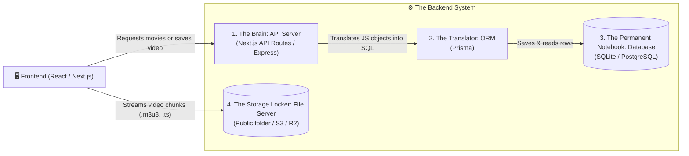
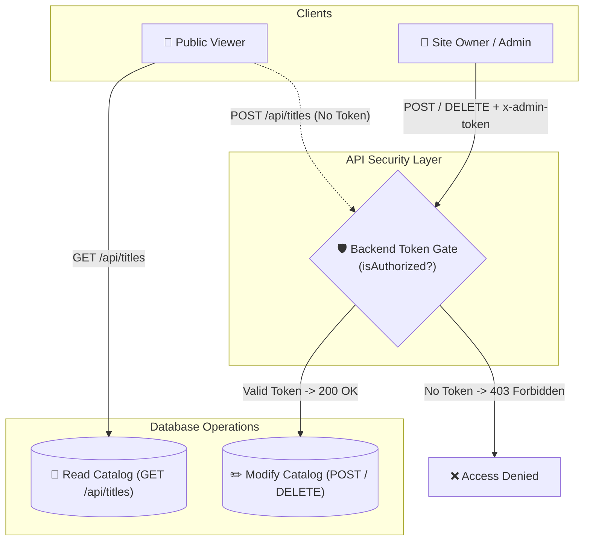

# Complete Beginner's Guide: How a Streaming Backend Works
*(From Zero Backend Knowledge to a Working Production Architecture)*

---

## 1. What Actually is a "Backend" & Why Do We Need It?

When you browse Netflix, Crunchyroll, or YouTube on your browser or phone, you are only interacting with the **Frontend** (the visual interface built with HTML, CSS, React, and buttons).

### The Problem with Frontend-Only:
If you add a movie, anime playlist, or watch progress inside React or browser memory, **everything vanishes** as soon as you refresh the page or open it on another device. Furthermore, your browser cannot store 50GB of movies or safely keep user passwords.

### The Backend's 4 Core Responsibilities:


| Component | Real-World Analogy | What It Does In Our App | Why We Use It |
| :--- | :--- | :--- | :--- |
| **API (Application Programming Interface)** | **The Waiter in a Restaurant** | Listens for requests from the browser (e.g. `POST /api/titles` to add a new movie). | Ensures clients can only do what's allowed. Never exposes the database directly to users. |
| **Database (SQLite)** | **The Permanent Ledger / Notebook** | Stores titles, episodes, seasons, genre tags, and where you paused. | Persists your data to disk in a single file (`dev.db`). No servers to configure or install! |
| **ORM (Prisma)** | **The Universal Translator** | Converts JavaScript objects (`prisma.title.create(...)`) into database SQL commands. | You never have to write complicated SQL by hand; you get TypeScript autocomplete and safety. |
| **Media Storage** | **The Warehouse / Locker** | Holds raw videos, converted `.m3u8` playlists, and thumbnail images. | Databases are built for fast text and numbers, not multi-gigabyte video files. |

---

## 2. Step-by-Step Data Flow: What Happens When You Add a Video

Let's walk through the exact steps when you submit a new video or anime playlist:

```mermaid
sequenceDiagram
    autonumber
    actor User as 👤 You (In Browser)
    participant UI as 🖥️ React Form (UI)
    participant API as 📡 Next.js API (/api/titles)
    participant Prisma as ⚙️ Prisma ORM
    participant DB as 💾 SQLite Database (dev.db)

    User->>UI: Types title "My Anime", adds 2 episodes, clicks "Save"
    UI->>API: Sends HTTP POST request with JSON payload
    API->>API: Validates data (checks title is not empty, URLs are valid)
    API->>Prisma: Calls prisma.title.create({ data: { ... } })
    Prisma->>DB: Executes SQL "INSERT INTO titles ...; INSERT INTO episodes ..."
    DB-->>Prisma: Returns confirmed saved records
    Prisma-->>API: Returns formatted Title object
    API-->>UI: Responds with HTTP 201 Created & saved Title
    UI-->>User: Instantly displays the new movie/anime in your catalog!
```

---

## 3. The Database Schema: Organizing Movies, Anime & Playlists

To support both **Single Movies** and **Multi-Episode Series / Anime Playlists**, we design a relational model:

```
[ Title ] (e.g., "Attack on Titan" or "Interstellar")
   │
   ├── type: 'movie' | 'series' | 'anime'
   ├── title, synopsis, releaseYear, posterUrl, backdropUrl
   │
   └── Has Many ──> [ Seasons ] (e.g., Season 1, Season 2)
                        │
                        └── Has Many ──> [ Episodes ] (Playlist Items)
                                            ├── episodeNumber: 1
                                            ├── title: "To You, in 2000 Years"
                                            ├── videoUrl: "https://.../stream.m3u8" or ".mp4"
                                            ├── duration: 1440 (seconds)
                                            ├── introStart: 90s, introEnd: 180s
```

### Why this design is flexible:
- If you add a **Movie**: It has its own `videoUrl` directly.
- If you add an **Anime or Playlist**: You can attach as many episodes as you want, each with its own title, video URL, and duration!

---

## 4. Key Concepts You Will Learn While Building This

1. **HTTP Methods:**
   - `GET`: Read / fetch data (e.g., fetch all movies).
   - `POST`: Create new data (e.g., add a new movie or playlist).
   - `PUT` / `PATCH`: Update existing data (e.g., edit episode title).
   - `DELETE`: Remove data (e.g., delete a video from your list).
2. **JSON (JavaScript Object Notation):** The universal language used by frontend and backend to talk to each other.
3. **Database Migrations:** Prisma's way of creating or updating tables inside the SQLite file automatically without losing existing rows.
4. **Heartbeat Playback Sync:** How the player periodically sends a `POST /api/progress` every 5 seconds so you can resume where you stopped.


---

## 5. Security & Role-Based Access Control (RBAC): Admin vs. Viewer

In a commercial streaming platform like Netflix, Disney+, or Crunchyroll, **regular users must only have read-only access**:
- ✅ **What Viewers Can Do:** Browse movies, search titles, watch video streams, maintain their watchlist, and update resume playback positions.
- ❌ **What Viewers Must NEVER Do:** Upload videos, edit metadata, delete episodes, or modify the catalog.



### Why Hiding Buttons in the UI is Not Enough:
A common beginner mistake is just removing the "Delete" button from HTML. However, a tech-savvy user can open their browser developer tools and send an HTTP `DELETE` request directly to `/api/titles/123`.

To prevent this, the **backend API** must enforce authorization on every request:
```typescript
// Inside /api/titles/route.ts
if (request.headers.get('x-admin-token') !== ADMIN_SECRET) {
  return NextResponse.json({ error: '403 Forbidden: Admin Only' }, { status: 403 });
}
```

### Authentication vs. Authorization:
- **Authentication:** *"Who are you?"* (e.g., verifying your Admin Passkey `admin123`).
- **Authorization:** *"What are you allowed to do?"* (e.g., checking if the caller has the Admin role before allowing a video to be written to the database).
