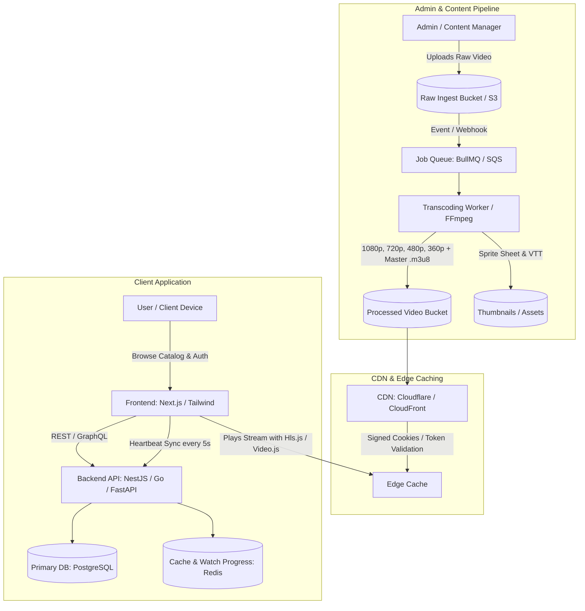

# Video Streaming Platform Engineering Roadmap & Implementation Guide
*(Architectural blueprint for building a Netflix / Crunchyroll / JioHotstar style platform)*

---

## 1. High-Level System Architecture

Streaming video at scale is fundamentally different from serving standard web assets. Serving raw MP4 files causes massive buffering, bandwidth waste, and poor UX on varying network connections. Modern platforms rely on **Adaptive Bitrate Streaming (ABR)** via **HLS (HTTP Live Streaming)** or **MPEG-DASH**.



---

## 2. Recommended Tech Stack

| Layer | Recommended Choice | Alternatives | Why this choice |
| :--- | :--- | :--- | :--- |
| **Frontend Framework** | **Next.js 14+ (App Router, React)** | Nuxt.js, SvelteKit | SEO for catalog pages, SSR performance, fast static generation. |
| **Video Player** | **Video.js** or **Shaka Player** / **Hls.js** | Plyr, MediaChrome | Robust HLS/DASH support, custom UI skinning, audio track & subtitle switching. |
| **Backend API** | **Node.js (NestJS or Fastify)** or **Go** | Python (FastAPI) | Great I/O concurrency for handling playback telemetry/heartbeats. |
| **Database** | **PostgreSQL + Prisma / Drizzle** | MySQL | Relational integrity for movies, episodes, seasons, subscriptions, and profiles. |
| **Cache & Realtime** | **Redis** | Dragonfly | Instant watch-time resume (`currentTime`), token blacklisting, caching catalog rows. |
| **Transcoding & Media** | **FFmpeg (Dockerized worker) or AWS MediaConvert** | Cloudflare Stream | FFmpeg allows total control over bitrates, subtitles, and sprite thumbnails at low cost. |
| **Storage & CDN** | **Cloudflare R2 + CDN** or **AWS S3 + CloudFront** | MinIO (Self-hosted) | Cloudflare R2 has **zero egress fees**, which drastically lowers video delivery costs. |
| **Search Engine** | **Meilisearch** or **Typesense** | Elasticsearch | Instant typo-tolerant search across titles, actors, genres, and anime tags. |

---

## 3. Step-by-Step Implementation Roadmap

### Phase 1: Core Catalog & Database Modeling
1. **User & Profile Management:**
   - Multi-profile architecture (e.g., Netflix: up to 5 profiles per account, Kid profile restrictions).
2. **Media Hierarchy (Movie vs TV Show / Anime):**
   - **Single Media (Movies):** Title, description, duration, age rating, release year, poster, backdrop, trailer URL.
   - **Episodic Media (Series / Anime):** Show $\rightarrow$ Seasons $\rightarrow$ Episodes (with episode titles, numbers, skip intro/outro timestamps).
3. **Draft Schema (PostgreSQL):**
   ```sql
   -- Core Schema Sample
   CREATE TABLE titles (
       id UUID PRIMARY KEY DEFAULT gen_random_uuid(),
       type VARCHAR(20) NOT NULL, -- 'MOVIE' or 'SERIES'
       title VARCHAR(255) NOT NULL,
       slug VARCHAR(255) UNIQUE NOT NULL,
       synopsis TEXT,
       thumbnail_url TEXT,
       banner_url TEXT,
       release_year INT,
       age_rating VARCHAR(10),
       created_at TIMESTAMP WITH TIME ZONE DEFAULT NOW()
   );

   CREATE TABLE episodes (
       id UUID PRIMARY KEY DEFAULT gen_random_uuid(),
       title_id UUID REFERENCES titles(id) ON DELETE CASCADE,
       season_number INT NOT NULL DEFAULT 1,
       episode_number INT NOT NULL,
       name VARCHAR(255),
       duration_seconds INT,
       intro_start_sec INT,
       intro_end_sec INT,
       video_manifest_url TEXT, -- master.m3u8
       thumbnail_sprite_url TEXT
   );

   CREATE TABLE watch_progress (
       id UUID PRIMARY KEY DEFAULT gen_random_uuid(),
       profile_id UUID NOT NULL,
       title_id UUID REFERENCES titles(id),
       episode_id UUID REFERENCES episodes(id),
       current_timestamp_seconds INT NOT NULL,
       completed BOOLEAN DEFAULT FALSE,
       last_watched_at TIMESTAMP WITH TIME ZONE DEFAULT NOW(),
       UNIQUE(profile_id, title_id, episode_id)
   );
   ```

---

### Phase 2: Video Transcoding & HLS Pipeline
Do not serve single `.mp4` files directly! Convert uploads into an HLS multi-bitrate playlist.

1. **How HLS Works:**
   - The video is split into small 4–6 second `.ts` or `.m4s` chunks.
   - A `master.m3u8` index file points to variant playlists (1080p, 720p, 480p, 360p).
   - The player measures user bandwidth and dynamically switches stream quality without pausing.
2. **FFmpeg Transcoding Pipeline Command:**
   ```bash
   ffmpeg -i input.mp4 \
     -filter_complex \
     "[0:v]split=3[v1],[v2],[v3]; \
      [v1]scale=w=1920:h=1080[v1out]; \
      [v2]scale=w=1280:h=720[v2out]; \
      [v3]scale=w=854:h=480[v3out]" \
     -map "[v1out]" -c:v:0 libx264 -b:v:0 4500k -maxrate:v:0 4800k -bufsize:v:0 6000k \
     -map "[v2out]" -c:v:1 libx264 -b:v:1 2500k -maxrate:v:1 2700k -bufsize:v:1 3500k \
     -map "[v3out]" -c:v:2 libx264 -b:v:2 1000k -maxrate:v:2 1200k -bufsize:v:2 1500k \
     -map a:0 -c:a:0 aac -b:a:0 128k \
     -map a:0 -c:a:1 aac -b:a:1 128k \
     -map a:0 -c:a:2 aac -b:a:2 96k \
     -f hls \
     -hls_time 6 \
     -hls_playlist_type vod \
     -hls_flags independent_segments \
     -master_pl_name master.m3u8 \
     -var_stream_map "v:0,a:0 v:1,a:1 v:2,a:2" \
     stream_%v/playlist.m3u8
   ```
3. **Generate Scrubbing Thumbnail Sprites & VTT:**
   - When hovering over the seekbar, show preview frames.
   - Extract a frame every 5 seconds and stitch into a montage grid using FFmpeg + ImageMagick.
   - Generate a `thumbnails.vtt` pointing to coordinates on the sprite sheet.

---

### Phase 3: Modern Video Player Engineering
Build a customized player component (using React + Video.js or Hls.js).

**Essential Features to Implement:**
- [x] **Adaptive Bitrate Switching:** Auto, 1080p, 720p, 480p, 360p selectors.
- [x] **Resume Playback:** Fetch `last_timestamp` on load; emit a heartbeat to the server every 5–10 seconds to update progress.
- [x] **Keyboard Shortcuts:** Space (Play/Pause), Left/Right arrow ($\pm 10$ seconds), Up/Down (Volume), F (Fullscreen), M (Mute).
- [x] **Skip Intro / Skip Outro:** Button overlays when video time falls within `[intro_start, intro_end]`.
- [x] **Next Episode Auto-countdown:** Trigger 15 seconds before episode completion.
- [x] **Audio & Subtitle Track Selector:** Parse WebVTT subtitle tracks.
- [x] **Scrubbing Preview:** Floating thumbnail frame preview while moving mouse over the progress bar.

---

### Phase 4: Security & Content Protection
Prevent direct hotlinking and scraping:
1. **Presigned URLs / Signed Cookies:**
   - Client requests playback permission from `/api/movies/:id/playback-token`.
   - Backend verifies authentication/subscription status and creates a signed token or sets a signed cookie valid for CloudFront/Cloudflare CDN.
   - Only requests with valid signatures can fetch `.m3u8` and `.ts` video chunks.
2. **Referrer & Origin Checking:** Restrict CDN requests to your frontend domain.
3. **Basic Watermarking (Optional):** Overlay dynamic user email/ID text subtly on the canvas/player to deter screen recording.
4. **DRM (Enterprise tier):** Widevine (Chrome/Android), FairPlay (Apple), PlayReady (Windows/Edge) through a license proxy (e.g., EZDRM, Axinom) if commercial studio licenses require it.

---

### Phase 5: UI/UX & Platform Features (Netflix/Prime/Crunchyroll Polish)
1. **Hero Billboard Banner:** Auto-playing muted video trailer with sound toggle.
2. **Row Carousels:**
   - "Continue Watching" (ordered by `last_watched_at` with progress bar indicator).
   - "Top 10 Today".
   - "Trending in Anime" / "Popular Movies".
   - Category / Genre carousels with horizontal smooth scroll and hover expansion.
3. **Watchlist / My List:** Fast toggle to add or remove items.
4. **Instant Search Modal:** Debounced search against Meilisearch with genre tags and cast filters.

---

## 4. Cost Optimization Strategy (Avoid Huge Cloud Bills)

> [!WARNING]
> Video delivery bandwidth is usually the most expensive part of building a streaming service if using standard AWS S3 egress ($0.09/GB).

1. **Storage & Egress:**
   - Prefer **Cloudflare R2** for storing processed video segments because R2 has **$0 egress fees**.
   - Alternatively, pair AWS S3 with **Cloudflare as a reverse proxy CDN** or use specialized video providers like **Bunny.net Stream** / **Mux**.
2. **Transcoding Costs:**
   - Managed services (AWS MediaConvert, Mux) are convenient ($0.015 - $0.03/min) but get expensive quickly.
   - **Budget approach:** Run a separate auto-scaling or background compute instance (e.g., Hetzner or spot instances) running FFmpeg in Docker to process queue jobs.

---

## 5. Milestone Checklist for Implementation

- [ ] **Milestone 1:** Initialize repository (Next.js frontend, NestJS/Node backend, PostgreSQL DB).
- [ ] **Milestone 2:** Setup database schema for Users, Profiles, Titles, Seasons, Episodes, and WatchProgress.
- [ ] **Milestone 3:** Build Admin Upload UI + FFmpeg worker to transcode sample `.mp4` into multi-resolution HLS (`.m3u8` + `.ts`).
- [ ] **Milestone 4:** Build the custom video player (HLS.js / Video.js) with quality switching and seek preview.
- [ ] **Milestone 5:** Implement Watch History Heartbeat (resume video from where left off).
- [ ] **Milestone 6:** Netflix-style browse interface (Hero trailer, Continue Watching row, Category carousels).
- [ ] **Milestone 7:** CDN edge security (Signed URLs or token authentication).
